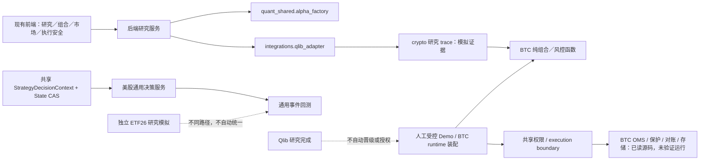

# QuantStation 源码架构地图与增量阅读账本

审阅基准：`7403c5331057cbba21b9c013b8d6c0ee4c517d91`。**固定范围2515文件／808857行已全部EOF。** 这是历史阅读基准，不随每次功能提交重写；阅读覆盖不授予交易权限。当前开发进度另见 [2026-09-29 开发状态](DEVELOPMENT-STATUS-20260929.md)，核查 HEAD 为 `3fc39879d14ecab2288368afe588385cc44c08e1`。

先读 [当前开发状态](DEVELOPMENT-STATUS-20260929.md)，再按需查看 [历史里程碑状态](MILESTONE-STATUS-20260913.md) 与 [全系统重评](REASSESSMENT.md)。catalog 是历史源码快照；保留 `review_status=in_progress` 表示整体交付／运行验收未认证，不表示仍有基准文件未读。

日常修改先读 [分层架构说明](LAYERED-ARCHITECTURE.md)：它提供25个模块输入输出边界、28张版本绑定的核心文件卡和普通文件分组索引；职责摘要不替代逐文件源码复核或原catalog阅读账本。

页面入口：`/architecture`，侧栏“架构地图”。独立于研究台、投资组合与执行安全。该页面不提供运行、晋级、交易或授权动作，不把文档中的安全约束伪装成后端授权快照。

## 单一证据源

[版本化清单](../../../frontend/src/workspaces/architecture/catalog.json) 是前端页面与本说明共用的证据源，包含：

- 范围内 Git-tracked 源码的路径、blob、行数和阅读状态。
- 逐文件 reader、batch、连续完整的 read_ranges。主代理与只读分工审阅分别记录，不能称全部由主代理亲自阅读。
- 模块职责、边界、引用行号及来源等级。
- 已发现但尚未修复／运行验证的问题与清理候选。

清单来自 Git 提交对象，不受 sparse checkout 是否把文件放到磁盘影响。扫描目录、统计行数、搜索引用和读取截断输出都不算通读。源码范围由 [只读检查器](../../../frontend/scripts/architecture-review.mjs) 的 CODE_ROOTS / CODE_EXTENSIONS 显式定义；依赖、数据、产物、锁文件、凭证、不透明对象不自动进入已读覆盖。

**地图是指定提交的源码快照**。地图自身新增文件，以及本票据对 App / Workbench 的接线，是后续代码变化，不会倒填为基准已读代码。

## 职责地图（不是一条已验证的执行链）



图中的实线表示基准源码已定位的调用关系，不表示本次运行验证通过；虚线表达明确的边界或待继续确认部分。精确证据行以 catalog 中 edges 为准。

## 当前判断的边界

1. 共享 Alpha 工厂已有生成、筛选、训练器注入和审计机制。其后台装配确实调用现有 Qlib workflow。共享引擎存在不意味着所有市场已经有有效输入与验收。
2. 普通 crypto Qlib pipeline 会生成七层研究 trace；factory trial 主要训练与返回预测分数，两种产物不等价。trace 的仓位、风控、执行是研究模拟，不是 BTC 运行授权。
3. 共享策略上下文、CAS 状态、权限状态机不是空接口。美股通用 engine 已接共享决策服务；专用 ETF 模拟、历史 crypto_event 与 BTC runtime 仍是不同路径。
4. BTC 的策略退出、组合／硬风控、OMS 保护单、账本对账各自有职责。不能为了统一地图重新实现交易系统，也不能仅因为代码在 quant_us 就认为按美股规则交易。
5. 已发现部分前端缺证时偏乐观的显示，以及旧研究模拟／统计验证口径差异。这里只登记，不代表已复现运行事故，不自动变成修复任务。
6. 市场状态 v2、历史诊断与 entry-only 条件政策已实现，但政策默认关闭；最新 A/B 条件臂在 `1956 / 2960` 因保护双触碰歧义 fail-closed，不能据此声称完整增量。旧 M2 没有稳定增量，M3—M4 未启动。
7. 完整策略包验证、审定、USDT 绑定与登记已接通；显式候选离线 worker 仅支持 `factory_lgbm_ast_v1` 且默认关闭。研究诊断准入不等于运行或交易准入。
8. Donchian 长历史执行能力已随 `441e057e2` 合入 main；自然历史阶段 `2960 / 8760` 小时已核账并发布只读 selector，但年度仍暂停。研究读取链已在 `3fc39879` 完成 `11 / 11` 正式页面场景验收。

## 增量阅读流程

阶段发现与尚未 EOF 的续接点另见 [阅读续接与未验证发现](REVIEW-NOTES.md)。只读分工的新增覆盖先记录，待下个快照入账；不要把部分文件的读取行数计为完整文件。

```powershell
node frontend/scripts/architecture-review.mjs --ref=HEAD
node frontend/scripts/architecture-review.mjs --ref=7403c5331057cbba21b9c013b8d6c0ee4c517d91
node --test frontend/scripts/test-architecture-map.mjs
```

检查器只读 Git 对象，不读取 dirty 文件内容、不读取运行 artifact、不执行模型、不访问网络或交易端点。

- 返回 changed / added / deleted / review_invalidated；变更过的已读文件需要重新审阅。
- 返回非零可能是正常源码漂移，也可能是目录合同错误，必须看 JSON 原因，不得当作研究／交易失败或通过。
- 工作树未提交变更须另外通过已声明路径的 safe_status 检查；这个脚本不代替 dirty 保护。
- 未读文件只能在实际 EOF 完成后更新，必须绑定确切 blob。来源文件改变后，其旧证据行不能继续冒充当前行。
- 下一次先看差异和未读清单，不重复从仓库根目录漫游。

新增审阅记录时只更新明确的批次和事实；不要重建研究／promotion 产物来让文档“看起来新鲜”。

## 清理原则

用户已允许整理无用代码，但删除必须在明确无消费者、动态入口／配置／测试兼容核对和局部回归后进行。本票据只记录候选，**没有删除任何业务文件或 helper**。Previous／Legacy 研究页仍有回退路由，BTC 历史恢复／演练／兼容出口仍有消费者，必须保留。

地图和文档采用单一 producer 票据；独立集成验收后才能在 current-main 页面验收。未完成阅读、服务运行、回归与权限验收始终分别标注。
