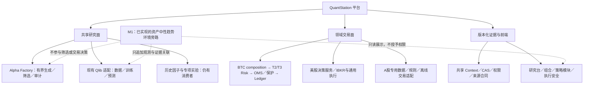

# 全系统源码重评与 M1 收敛方案

范围：固定 `7403c5331057cbba21b9c013b8d6c0ee4c517d91` 第一方代码、配置、schema、测试与运维脚本，共 **2515文件／808857行，全部EOF**。逐文件/blob/reader/EOF以 `frontend/src/workspaces/architecture/catalog.json` 为准；无剩余未读项。当前main增量 `f3a78afe0b59d432820dc8f50510038df6c00754` 已另读，见 REVIEW-NOTES。审阅由主代理与三名只读分工完成，不冒称全部由主代理亲读；源码审阅不是全系统运行验收。

> 时点说明：本文保留 M1 开发前的设计收敛与基准判断。2026-09-13 的实施、测试、历史运行验证和未完成项以 [里程碑状态](MILESTONE-STATUS-20260913.md) 为准。

## 一句话结论

应保留并逐步收敛现有系统，不宜推倒重写。共享研究底座、上下文和权限合同已存在，BTC也有独立的风险／OMS／保护／账本链；真正缺的是**同一版本的证据连接和一致的验收语义**，不是再创建一套BTC专用平台。

“有模块”“能生成报告”“测试通过”“真实研究有效”“执行已授权”是五种不同结论，不能再合并成一个完成状态。

## 现有架构怎样理解

实线是职责归属，不表示这一轮已跑通所有链路；M1 保留虚线表示只读旁路语义，不是尚未实现。精确调用证据见 catalog 的 edges 和里程碑状态页。

| 七层 | 当前源码结论 | M1应做／不做 |
| --- | --- | --- |
| Alpha | 共享工厂确有生成、评价、训练器注入、候选锁与审计；后端接现有Qlib。旧因子矿工与BTC专项GA不是同一流程，美股／A股工厂扩展注册仍空 | 复用引擎和任务；不新建BTC工厂，不改默认特征、搜索预算或选优指标 |
| 市场环境 | US状态模块、回测事后分组和BTC规则各自存在；尚无统一资产中性、可证明当时可见的多尺度环境观测 | 新增纯旁路观测；不直接当仓位乘数，不把事后状态当在线事实 |
| 风险 | BTC纯风险核、T2/T3、Guardian及硬阻断是真实实现；共享权限仍有领域约定 | 保持原评估输入、阈值、动作不变；环境失败不干扰默认风险链 |
| 组合优化 | Qlib→优化→目标与多个专用组合路径并存；部分报告用代理／合成收益，非统一真实优化器 | 仅展示研究来源和可用性，不承诺优化已完成或接管默认BTC目标 |
| 仓位管理 | BTC真实runtime composition与研究forecast/target不是同一最终目标来源 | 冻结实际默认目标计算；旁路开关不改变任何目标、状态或订单意图 |
| 退出／保护 | 策略退出、硬风控减仓、OMS保护单是不同职责；已有重启与操作并发保护 | 分别验证不变；不借环境建设修改退出、保护价、保护量或恢复规则 |
| 执行／账本 | BTC有真实dispatcher／OMS／持久化／对账路径；研究七层trace、旧raw-trend伴随OMS文件不能替代它 | 仅建立来源关联；不将研究fills当真实成交，不触发Demo/private/order/live |

关键代码锚点（均固定基准）：`quant_shared/alpha_factory/engine.py`；`integrations/qlib_adapter/research_pipeline.py:87`、`research_trace.py:328`；`quant_shared/strategy_runtime/`；`backend/app/services/btc_demo_runtime.py:892`；`quant_crypto/application/btc_demo_production_composition.py:1065`。详情和相反证据均保留在 REVIEW-NOTES，而不是只列有利路径。

## 应保留、应警惕、应推迟

保留：现有共享工厂与Qlib、Context/CAS、不可变数据resolver、领域风险核、OMS及保护／恢复／账本；尤其保留真正测试未来扰动不变、同周期幂等、单写者、崩溃恢复、fill去重和篡改拒绝的合同。

警惕三个系统性问题：

1. 研究口径分裂：旧回测中的全样本波动／状态切片、部分holdout参与排名、固定或随机研究指标，不能作为新环境模型的有效性基准。`crypto_event.py:955`、`portfolio_sim_bridge.py:176`等已登记。
2. 证据强度不一致：部分旧合同仅消费status／布尔／路径或manifest声明；例如表头CSV可以宣称120笔样本、单行可宣称31天。更深的DataReady内容验证确实存在，应复用它，不能从最弱“ready”导出权限。
3. 运行与显示混用：缺证时显示“开放／正常”、补造图点、CLI零退出、自然天与历史周期计数混淆。这些多数是展示／报告问题，不等于当前后端已经放开交易；必须分别验证。

另有重要静态安全疑点（例如只读broker审计context可能携带敏感字段、short保护映射、缺失回撤事实、IBKR去重与落账顺序），只登记为待隔离复现。**本次未读取秘密、未触发这些入口、未证实实际泄露或交易事故。**这些风险不自动扩成M1工程清单；需独立范围决定。

推迟：目录大迁移、统一所有历史模拟器、删除旧研究／回退页、改策略／风险参数、重新跑全仓历史实验。`quant_us`内的crypto工具仍有实消费者，不能仅按目录名搬走或删除。

## M1最小开发合同

目标只有一个：**相同研究版本下增加可追溯的趋势环境观测，同时证明默认BTC行为完全不变。**

### A. 先冻结再开发

- 选定默认BTC实际消费者、提交、参数、不可变数据manifest、时间范围和成本版本，生成本票自有、可重放的研究基准。冻结不是在原mutable latest上覆盖文件。
- 复用已有Context不可变／CAS／restart parity、BTC组合退出／纯风险／OMS／账本测试，补一条默认装配的行为对照。人工fixture只能证明合同，实际生产者到消费者要另有连接测试。
- 对照字段包括信号、目标仓位、退出原因、风险决定、订单意图、保护动作、fill／position／cash／PnL与持久状态；排除明确无业务意义的运行时戳后做规范化比较。

### B. 只增加资产中性旁路

- 共享层实现纯环境估计函数，不导入broker、OMS或领域交易实现。输入为资产身份、已完成bar、decision/available time、周期／日历及冻结配置；不把BTC的24×7年化硬编码给美股或A股。
- 首版只输出按资产×趋势尺度的方向／适配度、波动、冲击、状态切换观测，以及warmup／缺失／过期／输入无效原因。只使用历史可见窗口；不引入全样本标准化，不把未校准连续分数称为概率。
- 输出绑定model/config/data/code/run版本和输入hash。缺数据明确unknown/blocked，禁止补造正常值；旧run保持“无环境证据”，不隐式重算。
- M1不向策略特征矩阵、筛选目标、risk input、TargetPosition或OMS写入环境分数；先使用独立sidecar引用。共享context若需扩展，只增加可选版本化证据引用，禁止改变旧字段和默认计算。

### C. 两条已有研究入口贯通

- 普通Qlib研究与Factory trial调用同一旁路生产逻辑、同一版本合同；Factory没有七层runtime trace时如实显示缺失，不能复制普通Qlib trace填充。
- 研究任务／结果接口关联同一run、candidate、data/code/config版本；禁止跨run借用latest。旁路失败被记录，不把主研究结果或交易状态伪装成完成。
- 现有研究台负责观测与研究结果，组合页负责其实际选用的研究版本，策略模块页分开机制说明／候选配置／研究观测／运行事实；无需再造专用控制台。

### D. 有限验收与停止条件

| 验收组 | 必须证明 | 不代表什么 |
| --- | --- | --- |
| 因果／资产中性 | 未来行扰动不影响历史输出；可见时间、warmup、缺失、NaN／无穷、资产／周期隔离；BTC／US／CN日历合同 | 合成US/CN fixture不是市场已接通 |
| 兼容／行为 | 默认关闭、显式旁路开启、旁路失败三种情况下默认BTC业务输出一致；旧Context、旧run可读 | 不是放开paper或live |
| 证据贯通 | Qlib与Factory真实生产者→持久化→API→现有页面引用一致；hash／版本错配、缺失与过期均显式失败 | 不是报告布尔自证 |
| 安全／前端 | 无broker／订单访问；研究完成无授权；旧导航与回退保留；current-main身份及定向浏览器回归 | 不是全系统实盘准备完成 |

通过上述固定验收后交独立验收并停止，不为提高分数追加参数搜索、HMM、宏观特征或全仓重构。数据／自然时间／服务或授权阻塞只报告，不用增加工程循环掩盖。

## 后续里程碑判断

M1 已按本文的有限合同完成独立工程验收。M2 后续按用户授权改为历史探索对照并完成 8/8 次训练；本版环境特征没有显示整体且稳定的增量，因此不进入默认决策、不追加搜索。

**M3—M4 仍未启动。** 历史研究完成不是真实账户、执行或交易授权证据；下一里程碑须单独定义范围与验收门槛。

## 清理与回退

本轮零业务删除、零策略／风险／OMS／账本变更。未引用声明仅是清理候选，必须进一步核对动态入口、配置、历史恢复和兼容测试后才能删。旧版研究页面保留。

本文保留原设计收敛过程；已提交并受独立验收的 M1 实现与 M2 历史结果按里程碑页的精确 commit、hash 和 as-of 引用，不借用历史快照声称 current-head 运行已验收。
