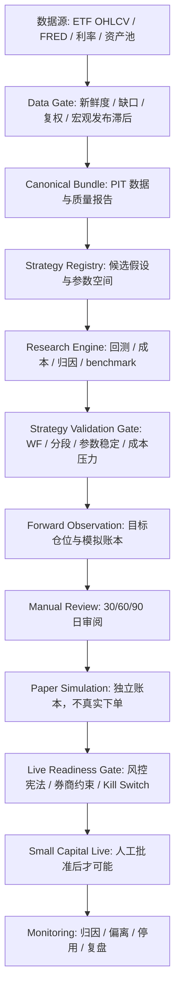

# US Equity 美股系统开发规划

生成日期：2026-06-25
角色定位：量化架构师
当前目标：把美股 ETF 轮动系统从“研究候选 + forward observation”推进为可持续验证、执行、复盘、淘汰和扩展的轻量机构化系统。
硬边界：本文不解锁实盘；不允许 broker/private/order endpoint；不把 forward observation 等同于策略有效。

## 1. 学习范围和方法

本规划不是只看目录或摘要，而是基于量化书籍库中的正文级 MD 扫描和当前系统产物复核。正文扫描覆盖 `21` 个大体量 MD，约 `16,764,750` 字节，主题包括趋势/动量、组合风险、验证、交易成本、数据工程、宏观状态、监控治理。

主要正文来源：

| 正文来源 | 对美股系统的架构启发 |
|---|---|
| `151 Trading Strategies - Zura Kakushadze and Juan Andres Serur - 原文.md` | 策略库要变成假设注册表和统一验证流水线，不能把大量策略逐条照搬后按收益率挑选。 |
| `Trading Systems and Methods - Perry Kaufman - 原文.md` | 趋势、突破、均线、波动率、过滤器都可以做候选，但必须统一成本、换手、参数邻域和失效规则。 |
| `Quantitative Momentum - Gray and Vogel - 原文.md` | 美股/ETF 动量要重视横截面选择、动量崩溃、样本外和与基准的替代价值。 |
| `Dual Momentum Investing - Gary Antonacci - 原文.md` | ETF 轮动适合结合横截面相对强弱和绝对动量/防御资产切换。 |
| `Time Series Momentum - Moskowitz Ooi Pedersen - OCR全文.md` | 时间序列动量可以作为风险资产暴露管理和宏观风险开关的基础。 |
| `Systematic Trading - Robert Carver - 原文.md` | 信号、预测、风险目标、仓位和执行必须分层，杠杆不是收益来源的替代品。 |
| `Advanced Futures Trading Strategies - Robert Carver - 原文.md` | 多策略/多资产应先做风险预算和组合层控制，不应只叠加漂亮回测。 |
| `Following the Trend - Andreas Clenow - 原文.md` | 趋势系统的核心是持续执行和风险控制，不是寻找最神奇的参数。 |
| `The Trend Following Bible - Andrew Abraham - 原文.md` | 趋势策略必须接受长时间低迷期，并提前定义停用和复核标准。 |
| `海龟交易法则 - Curtis Faith - OCR校对版.md` | 突破、ATR、仓位单位和止损思想可借鉴，但美股 ETF 月度轮动不能机械套用海龟期货逻辑。 |
| `Expected Returns - Antti Ilmanen - 原文.md` | 策略收益要拆成可解释风险溢价：动量、carry、宏观风险、流动性、杠杆成本。 |
| `Expected Returns on Major Asset Classes - CFA Research Foundation.md` | 基准和资产类别预期收益要长期化，不能用单一牛市区间做判断。 |
| `Efficiently Inefficient - Lasse Heje Pedersen - 原文.md` | 策略有效性来自市场结构和约束，不是只来自指标；容量和交易成本是收益的一部分。 |
| `Evidence-Based Technical Analysis - David Aronson - 原文.md` | 技术策略必须防数据挖掘、过拟合和多重检验偏差。 |
| `Advances in Financial Machine Learning - Marcos Lopez de Prado - 原文.md` | 如果未来引入 ML，必须先处理标签、泄漏、交叉验证、样本重叠和特征重要性。当前不应急着上 ML。 |
| `Quantitative Trading - Ernest P. Chan - 原文.md` | 个人量化系统要先跑通研究、回测、风控、纸面执行、监控的闭环。 |
| `打开量化投资的黑箱（第2版）-OCR全文.md` | 量化生产线应拆成数据、Alpha、组合、交易、风控、执行和监控。 |
| `因子投资方法与实践 - 石川 刘洋溢 连祥斌 - 原文.md` | 因子研究要统一 IC、分组、换手、成本和失效分析；美股因子扩展不能只看收益曲线。 |

正文扫描得到的主题密度也支持这个方向：趋势/动量、数据工程、组合风险、宏观状态、交易成本和监控治理是美股系统最相关的六条主线。

## 2. 当前美股系统状态

当前系统已经不是“只有一个回测脚本”的状态，但还不是可实盘系统。

已完成：

- 外部 ETF 轮动策略已接入研究链路，不再只依赖原始脚本。
- ETF 数据质量已做过全体扫描和修复，SPY 异常复权跳点、QQQ 2005-2011 长缺口已处理。
- FRED 宏观数据已通过 API key 路径解决过无 key/CSV 路径连接失败问题。
- 已完成原始语义诊断、成本压力、walk-forward、参数稳定性、年份归因、容量测试、DBMF 流动性处理。
- 当前主候选：`min_adv_10m_to_shv + vol_target_20pct_cap1.5x`。
- 账户假设：`10,000 USD`。
- 当前候选策略卡已落地：`学习资料/量化交易业务闭环/系统评估/US ETF 轮动 主候选策略卡.md`。
- forward observation runner 已落地：`scripts/run_us_etf_rotation_forward_observation.py`。
- 独立观察账本：`data/forward_observation/us_etf_rotation_v1`。

当前主要结果：

| 项目 | 当前读数 |
|---|---:|
| 选中变体 CAGR | 20.36% |
| 选中变体 MDD | -23.58% |
| 选中变体 Sharpe | 1.041 |
| 可交易约束版本 CAGR | 21.82% |
| 可交易约束版本 MDD | -23.81% |
| 可交易约束版本 Sharpe | 1.103 |
| Walk-forward OOS CAGR | 16.60% |
| 25bps 成本压力 CAGR | 17.29% |
| 50bps 成本压力 CAGR | 14.30% |
| 当前 forward observation 状态 | observation only |
| 实盘状态 | locked |

关键限制：

- 目前只有 forward observation 的第一阶段记录，不足以证明策略可实盘。
- 1.5x 版本不能直接实盘；小资金也要先验证 1x 或极低杠杆执行路径。
- 当前候选依赖外部 ETF/FRED 数据链，数据新鲜度和质量必须每日可验证。
- DBMF 虽已加最小 ADV 转 SHV 约束，但仍要持续检查流动性和替代逻辑。
- 目前还缺独立的 `strategy_validation_gate`，需要把“观察链路可运行”和“策略通过验证”彻底分开。

## 3. 架构原则

### 3.1 先生产线，后策略扩张

美股系统下一步不应该继续无边界寻找策略，而是把策略生产线固化：

```text
数据入库
-> 数据质量与时点校验
-> 策略假设注册
-> 标准化回测
-> 成本/流动性/容量压力
-> Walk-forward 与参数稳定性
-> 策略验证门槛
-> Forward observation
-> 人工审阅
-> 纸面模拟
-> 小资金实盘前门禁
-> 监控、归因、停用、迭代
```

### 3.2 信号、组合、执行必须解耦

当前 ETF 轮动策略要拆成三层：

- Alpha 信号：横截面动量、绝对动量、宏观开关。
- 组合构建：目标权重、波动率缩放、杠杆上限、防御资产、流动性替换。
- 执行模拟：目标仓位、差额、股数、滑点、融资、账本复算。

不能让单个脚本同时承担下载数据、生成信号、决定杠杆、模拟成交和给出实盘结论。

### 3.3 参数优化让位于参数稳定性

当前策略不应追求“最漂亮的一组参数”。正确问题是：

- 一片合理参数区域是否都能活？
- 换手、成本、融资利率上升后是否仍能活？
- 在 2018、2020、2022、2023、2024、2025、2026 这些不同环境中是否有解释力？
- 收益是否来自资产选择，还是主要来自杠杆？
- 若剔除某个年份或某个 ETF，结论是否崩塌？

### 3.4 Forward observation 不是 Alpha 验证

forward observation 只验证运行质量：

- 每日或调仓日能否稳定生成目标仓位。
- 数据是否新鲜。
- 账本是否可复算。
- T+1 或调仓规则是否没有未来函数。
- 费用和融资估计是否一致。
- 目标仓位变化是否可解释。

它不能证明长期正期望，也不能自动解锁实盘。

### 3.5 10,000 美元账户要有硬约束

当前用户本金规模决定了系统要先解决可交易性，而不是追求机构级容量：

- 初始不建议 1.5x 直接实盘。
- 若未来小资金实盘，优先 1x 或极低杠杆。
- 支持碎股与否要进入 preflight。
- 单笔预计成交金额、最小成交额、最小股数、融资成本、保证金规则必须可复算。
- 若券商不支持碎股，权重转股数后的偏离必须进入组合构建层，而不是事后忽略。

## 4. 目标系统架构



## 5. 开发路线

### Phase 0：冻结当前候选定义

目标：防止在 forward observation 期间反复改策略。

当前冻结口径：

- 主候选：`us_etf_rotation_min_adv_10m_vol_target_20pct_cap1_5x`。
- 研究变体：`min_adv_10m_to_shv + vol_target_20pct_cap1.5x`。
- 当前状态：`forward_observation_only`。
- 不允许：改动参数后继续沿用同一个策略 ID。
- 不允许：因为 forward observation 能跑就标记 paper/live ready。

验收产物：

- `US ETF 轮动 主候选策略卡.md`
- `us_etf_forward_observation_roll_report.json`
- `data/forward_observation/us_etf_rotation_v1/validation_state.json`

### Phase 1：数据链路硬化

目标：让美股系统每天知道“数据是否可信、是否新鲜、是否可用于生成新目标仓位”。

需要新增或完善：

- `us_equity_data_freshness_daily_report.json`
- ETF kline 全量质量扫描日更。
- FRED 宏观数据新鲜度日更。
- 宏观数据发布滞后字段，避免把未来发布的数据用于过去调仓。
- 外部数据湖与 canonical bundle 的对账报告。
- QQQ/SPY 等关键基准的异常收益阈值检查。
- 数据失败时 runner 必须输出 `BLOCKED`，不得沿用旧信号伪装成新观察。

最低测试：

- ETF 价格 stale 时 forward observation 阻断。
- FRED stale 时根据策略依赖决定阻断或降级为 neutral macro，并在报告中显式记录。
- 任一标的出现非正价格或极端跳点，候选验证报告必须降级。
- 宏观数据不得使用调仓日之后才发布的值。

### Phase 2：独立 Strategy Validation Gate

目标：把“策略是否通过研究验证”从“runner 能否运行”中拆出来。

新增报告：

```text
artifacts/us_equity_etf_macro_rotation/latest/us_etf_strategy_validation_gate_report.json
学习资料/量化交易业务闭环/系统评估/US ETF 轮动 策略验证门槛.md
```

状态只允许：

- `research_only`
- `validation_passed_for_forward_observation`
- `rejected`
- `blocked_data_quality`

默认检查：

- 数据覆盖与质量通过。
- 无未来函数。
- 回测与外部原始策略语义差异已解释。
- benchmark 必须包括 SPY、QQQ、60/40、SHV/cash。
- CAGR、Vol、Sharpe、MDD、Calmar、Turnover、Cost-stressed return、Liquidity pass/fail 全部齐全。
- walk-forward OOS 不崩。
- 参数邻域不是单点有效。
- 10bps、25bps、50bps 成本压力后不崩。
- 1 万、5 万、10 万、50 万、100 万容量测试齐全。
- 收益来源拆成资产选择、宏观开关、防御资产、波动率缩放、杠杆/融资影响。

硬规则：

- `strategy_validation_gate` 通过，只代表允许进入或继续 forward observation。
- 不允许输出 `live_ready=true`。
- 不允许调用交易端点。

### Phase 3：Forward Observation 30/60/90 日评估

目标：验证真实滚动环境中的稳定性，而不是继续优化历史收益。

新增报告：

```text
artifacts/us_equity_etf_macro_rotation/latest/us_etf_forward_observation_evaluation_report.json
学习资料/量化交易业务闭环/系统评估/US ETF 轮动 Forward Observation 评估.md
```

评估维度：

- 观察天数。
- 调仓周期数。
- 目标仓位变化次数。
- 模拟成交次数。
- 账本复算状态。
- 当前仓位和目标仓位偏离。
- 预计滑点和融资费用。
- 与研究规则的一致性。
- 数据新鲜度失败次数。
- 是否出现重复写入、漏写、未来函数迹象。

状态只允许：

- `forward_observing`
- `forward_complete_for_manual_review`
- `forward_blocked`

硬规则：

- 满 30 日只进入人工审阅，不自动进入纸盘。
- 满 60/90 日后仍需人工审阅策略逻辑、数据质量、容量、成本和账户约束。
- 若期间改策略参数，观察天数清零或新建策略 ID。

### Phase 4：组合构建与小账户约束

目标：把目标权重变成 10,000 美元账户能真实执行的目标订单模型。

需要新增：

- 1x 版本、低杠杆版本、1.5x 研究版本三条独立曲线。
- 整股/碎股 preflight。
- 现金余额与融资占用估计。
- 最小交易金额过滤。
- 组合权重转股数后的偏离报告。
- 手续费、滑点、融资利率、保证金要求的统一模型。

优先结论：

- 研究候选可以保留 1.5x 作为上限研究。
- 初始实盘若未来发生，默认先评估 1x 或极低杠杆。
- 杠杆收益必须单独归因，不得和 Alpha 混在一起。

### Phase 5：策略池扩展

目标：在主候选稳定后，按统一 evidence schema 扩展策略，不再临时拼脚本。

优先策略族：

| 优先级 | 策略族 | 来源启发 | 备注 |
|---:|---|---|---|
| 1 | ETF 横截面动量 + 绝对动量防御 | Quantitative Momentum / Dual Momentum | 当前主线的自然扩展。 |
| 1 | 风险资产趋势过滤 + SHV/IEF 防御 | TSMOM / Expected Returns | 用于降低宏观压力期暴露。 |
| 2 | Top N 分散版本 | Carver / Portfolio risk | 解决 Top1 单资产风险，但要看收益是否显著下降。 |
| 2 | 低波动/质量/动量 ETF 组合 | 因子投资 / APM | 作为美股因子化扩展，不急于实盘。 |
| 2 | 宏观 regime overlay | Expected Returns / Efficiently Inefficient | 需要严格处理 FRED 发布滞后。 |
| 3 | 151 Trading Strategies 候选移植 | 151 Trading Strategies | 只进入假设注册表，逐条做统一验证，不按样本内收益挑。 |
| 3 | ML 特征和标签 | AFML | 数据和验证框架成熟前暂缓。 |

扩展原则：

- 新策略必须先有 strategy card。
- 必须进入统一回测和验证门槛。
- 必须和当前主候选做相关性、组合边际贡献和替代价值比较。
- 不能因为某策略跑赢 QQQ 就直接晋级；也不能因为短期跑输 QQQ 就直接否定，必须看风险、回撤、周期和目标约束。

### Phase 6：纸面模拟与实盘前门禁

目标：未来若要进入纸面模拟或小资金实盘，必须先完成风控宪法和只读/模拟执行验证。

需要新增：

```text
学习资料/量化交易业务闭环/系统评估/US Equity 实盘前风控宪法.md
artifacts/us_equity_etf_macro_rotation/latest/us_equity_live_readiness_report.json
```

风控宪法必须包括：

- 最大本金。
- 最大 gross exposure。
- 初始杠杆上限。
- 单日最大亏损停机线。
- 最大回撤停机线。
- 连续亏损复核线。
- 数据 stale 停机。
- FRED/ETF 更新失败停机。
- 券商连接异常停机。
- 目标仓位和实际仓位偏离阈值。
- 手动确认流程。
- 禁止自动从 paper/forward 切到 live。

实盘前必须证明：

- paper ledger 和 target ledger 可复算。
- 订单状态机能处理部分成交、撤单、拒单、断线、重连。
- 仓位、现金、融资、费用与券商对账。
- 所有真实下单入口默认关闭。
- 任何 live session 必须人工批准，并且只允许小金额、低杠杆、可回滚。

## 6. 标准报告 Schema

所有美股策略报告必须统一这些字段：

| 字段 | 要求 |
|---|---|
| `strategy_id` | 不可变，参数变动必须新 ID 或新 version。 |
| `candidate_variant` | 具体候选变体。 |
| `data_status` | 覆盖、最新日期、缺口、异常价格、宏观新鲜度。 |
| `metrics` | CAGR、Vol、Sharpe、MDD、Calmar、Turnover。 |
| `benchmarks` | SPY、QQQ、60/40、cash/SHV。 |
| `cost_stress` | 0bps、10bps、25bps、50bps。 |
| `liquidity` | ADV、参与率、容量、低流动性替代。 |
| `attribution` | 资产选择、宏观开关、防御资产、杠杆、融资、滑点。 |
| `walk_forward` | OOS 年份、参数、收益、回撤。 |
| `parameter_stability` | 邻域矩阵和通过比例。 |
| `guardrails` | private/order/live flags 全部 false。 |
| `decision` | research/validation/forward/paper/live 阶段明确分离。 |

## 7. 近期开发优先级

### P0：保持当前 forward observation 每日推进

任务：

- 确保 `scripts/run_us_etf_rotation_forward_observation.py` 可日更运行。
- 每次运行写入 target、fills、snapshot、validation_state。
- 重复日期幂等，不重复写账本。
- 数据 stale 或验证报告异常时 fail closed。

验收：

- `us_etf_forward_observation_roll_report.json.status == PASS` 或明确 `BLOCKED`。
- `live_order_allowed=false`。
- `real_order_submitted=false`。

### P1：补 strategy_validation_gate

任务：

- 新增 `scripts/build_us_etf_strategy_validation_gate_report.py`。
- 合并现有专项验证、成本压力、walk-forward、参数稳定、容量和策略卡。
- 输出机器可读 JSON 和人工审阅 MD。

验收：

- gate 通过也只允许 `validation_passed_for_forward_observation`。
- gate 不得输出 live ready。
- 数据质量失败时状态为 `blocked_data_quality`。

### P2：补 forward observation evaluation

任务：

- 新增 `scripts/build_us_etf_forward_observation_evaluation_report.py`。
- 30/60/90 日分层输出。
- 对账本、目标仓位、模拟成交、费用和规则一致性做复算。

验收：

- 少于 30 日输出 `forward_observing`。
- 满 30 日输出 `forward_complete_for_manual_review`。
- 任意复算失败输出 `forward_blocked`。

### P3：写实盘前风控宪法

任务：

- 将 10,000 美元账户、1x 优先、低杠杆、融资、整股/碎股、停机线写成硬规则。
- 明确“1.5x 是研究上限，不是默认实盘配置”。

验收：

- 风控宪法成为 live readiness gate 的必需输入。
- 没有风控宪法时 live readiness 必须 `BLOCKED`。

### P4：策略池注册表

任务：

- 新增 `us_equity_strategy_registry.yaml` 或 JSON。
- 把当前主候选、dual momentum、absolute momentum、TopN、regime overlay、151 候选迁移作为注册项。

验收：

- 每个策略有假设、收益来源、参数空间、数据依赖、成本模型、失效条件。
- 未注册策略不得进入正式验证报告。

## 8. 当前不该做的事

- 不直接实盘。
- 不把 1.5x 研究版本直接用于真实资金。
- 不继续为了追 CAGR 做无边界参数优化。
- 不在未处理宏观发布滞后的情况下扩大宏观开关权重。
- 不因为 QQQ 后验表现强就手动倾斜科技资产。
- 不把 `151 Trading Strategies` 里的策略直接批量跑完后按收益率筛选。
- 不复用 BTC 的账本或 paper runner 概念到美股；美股要有独立 schema 和独立 ledger。

## 9. 架构师结论

美股系统当前已经有可用骨架：数据修复、ETF 轮动回测、成本压力、walk-forward、容量测试、策略卡和 forward observation runner 都已经落地。下一步的核心不是再找一个更漂亮的策略，而是补齐生产线中最关键的三件事：

1. 独立 `strategy_validation_gate`，判断策略研究证据是否足够。
2. `forward observation evaluation`，判断真实滚动环境是否稳定。
3. `live readiness / 风控宪法`，把未来实盘可能性锁在严格门禁后面。

只有这三件事完成后，美股系统才接近“能持续验证、执行、复盘、淘汰和扩展策略”的系统。当前可以继续观察，不可以实盘。
